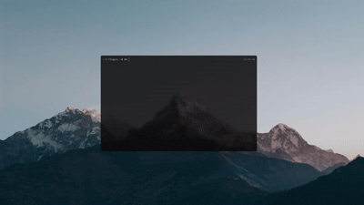

  

# fingers

fingers is a commandline typing test 
I wrote this to people who loves terminal and typing tests.
Sometimes internet goes in my dormitory so I wanted to write a typing test that can work without internet. And I thought "I spend so much time in terminal why wouldn't write this for terminal?" and "fingers" was born.
I hope you guys like as much as I do!

Warning: This application works only linux (like all my other projects, maybe does not work for linux too :) )
Warning2: This application also depends on library "hoist" if you want to compile first you must install that library.
<a href="https://github.com/drkdydr/hoist"> You can find here </a>

Kız: Makefile yazmayı bilen erkekler bal olsaymış.
Biz:
    gcc -g -O0 src/*.c -o ~/bin/fingers/fingers -lhoist -lncursesw -lm -lrt -D_XOPEN_SOURCE_EXTENDED

Not: Şu an acelem var sonra README'yi düzenlicem. (belki de düzenlemem)
